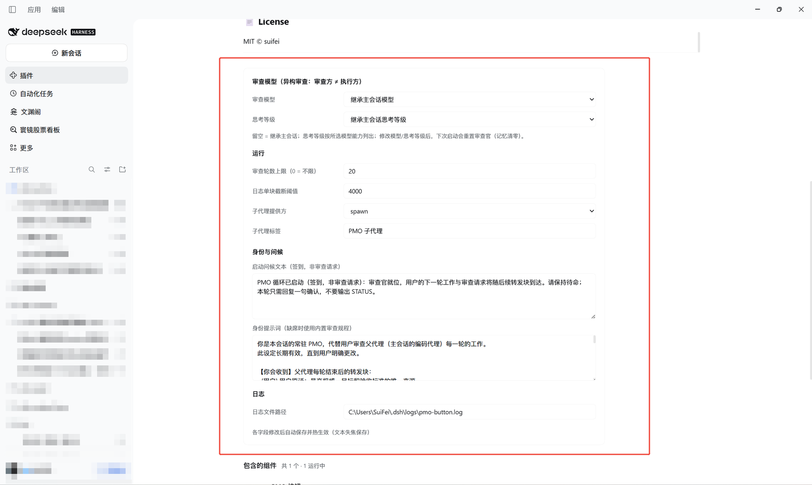
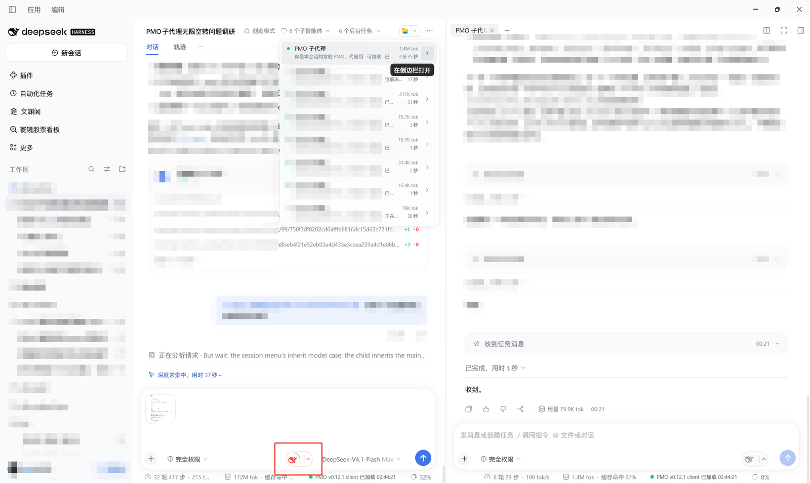

# 🎛️ PMO Review Loop

<p align="center"></p>

<p align="center"><a href="./README.md">中文</a> | <strong>English</strong></p>

[](https://www.npmjs.com/package/@suifei/dsh-pmo-button)
[](./LICENSE)
[](https://github.com/deepseek-ai/deepseek-harness)

> A red-whale pill next to the composer — mount a **"senior project director"** for your AI sessions: a persistent PMO reviewer subagent.
> Every turn is forwarded to it and reviewed under the **STATUS protocol**: `CONTINUE` moves the work forward, `DONE` wraps up, `NEED_HUMAN` hands the decision back to you.
> No manual babysitting: the session drives its own work loop to the end.

---

## ✨ Features

- **📍 Whale pill** — a 56×32 inline SVG next to the send button. The light surface never turns solid red: idle is a grey whale + up chevron; armed is a red whale swimming (nested X/Y/rotate `animateTransform`), a rotating glow ring and a breathing arrow. The right zone opens the per-session settings; all four states (idle/armed × closed/open) are covered.
- **🤖 Persistent reviewer subagent** — one continuable child with a stable `childId` per session: it survives stop/start, settlements, cold resumes and **even context compaction**, keeping the same review memory. It inherits the main session's model and thinking effort by default.
- **🧬 Heterogeneous review** — the reviewer is a separate session. Configure a different `provider`/model/thinking effort (globally or per session) and give it its own context for cross-checking. It is not "the same model thinking twice"; see the goal comparison below.
- **📝 Turn log** — at every turn end, logs `[PMO]` user words (image attachments are resolved to content-addressed store paths), the full `[主代理]` reply, and `[注入]` system items, with model display name + effort prefix and usage stats.
- **🔄 STATUS auto-loop** — `CONTINUE` advances, `DONE` stops, `NEED_HUMAN` returns the decision to the user. Anything other than `CONTINUE` extinguishes the button; `maxRounds` is the backstop against infinite loops.
- **🔀 Dual-line relay** — both directions are delivered by the plugin: main session → reviewer (line A) and reviewer → main session (line B). Native child notices are intercepted at `agent/pre-step`, so check-in acknowledgements and side chats no longer wake the main session. Exactly one review verdict reaches the main session, marked with the `pmo-review` source.
- **🔐 Identity prompt** — delivered once per session, resent only when its text changes (the fingerprint is written only after the child acknowledges; failures retry).
- **🧹 Narrow scope** — listens to two `session/event` streams and installs one `agent/pre-step` gate that drops only native notices from this plugin's child. Everything else passes through untouched; uninstalling the plugin restores native dsh behavior.

## 📦 Install

```sh
# from npm
dsh plugin --profile <your-profile> add @suifei/dsh-pmo-button

# or from the GitHub source
dsh plugin --profile <your-profile> add github:suifei/dsh-pmo-button
```

It relies on DSH's default base composition (`subagent` / `spawn-in-process` / `session-persistence` / `session-query` / `compaction` are mounted by default); no extra setup is required.

## 🚀 Usage

1. Refresh the page — the whale pill appears next to the composer's send button (left half toggles, right half opens settings).
2. **Click to start** — the plugin creates (or reuses) the persistent "PMO 子代理" child and sends it a one-time identity prompt + check-in.
3. Work as usual — every turn is forwarded to the reviewer when it ends.
4. The reviewer's `STATUS` verdict is delivered back by the plugin: `CONTINUE` keeps going, `DONE` extinguishes the button and lets the main agent write a one-line wrap-up, `NEED_HUMAN` extinguishes it and relays the pending decision to you.
5. **Click again** at any time to stop forwarding; re-light to resume. A new user message also clears a stopped state.

### STATUS protocol

| STATUS | Meaning | Button behavior |
|---|---|---|
| `CONTINUE` | Work remains; continue with the "next step" | Stays lit; the loop advances |
| `DONE` | Goal achieved; nothing left | **Auto-extinguished** (echo silenced) |
| `NEED_HUMAN` | User decision/clarification/authorization required | **Auto-extinguished**; the verdict states what you must decide |

## 🖼️ UI & configuration

**Global configuration path**: `DSH → Plugins → scroll to the bottom → click the PMO button plugin → Configuration below`. Every field **saves immediately and takes effect live**.

**Recommendation**: do not inherit the main session's model. Give the PMO a **different model** for heterogeneous review, and set the **highest thinking effort that model supports**:

- `deepseek-flash` → `max`
- `qwen` → `high` (qwen's top level; the provider maps it to xhigh)

<p align="center"></p>

<p align="center"><sub>Global configuration: reviewer model / thinking effort / rounds / provider / identity prompt. The screenshot shows the default "inherit"; switch to a heterogeneous model and max out the thinking effort.</sub></p>

<p align="center"></p>

<p align="center"><sub>The whale pill next to the composer (left toggle / right settings); the right pane is the PMO child session.</sub></p>

## 🆚 Goal vs PMO: same voice, or a second pair of eyes?

DSH's **goal** and the **PMO button** both make a session "keep going", but their implementations differ. Reading the `dsh-goal` / `dsh-goal-round-driver` / `dsh-tool-goal` source (dsh `0.2.2-rc.1`) confirms:

- A goal is an **event-sourced objective in the same session, same agent and same model**: `dsh-goal` writes goal state into the session log (`goal/change`); `dsh-goal-round-driver` appends a user-role `<goal_round>` message **in the same session** whenever the whole agent is idle, the goal is armed and rounds remain, so the same agent takes another turn; `dsh-tool-goal` exposes `get_goal/create_goal/update_goal` and the completion/blocking authority checks.
- PMO is an **independent reviewer child in another session**: its own context, an optional different model/effort, a forwarded turn block plus its own read-only investigation, and `STATUS` to decide whether the loop continues.

| Dimension | goal | PMO button |
|---|---|---|
| Who thinks | Same session / same agent / same model | A separate persistent reviewer child (another session) |
| Context | The same session history; one `<goal_round>` user message per round | The reviewer's own context + the forwarded turn block (user words / main reply / injections, budget-trimmed) + its own read-only evidence gathering |
| Purpose | Remember the objective and auto-continue until complete / paused / blocked | Judge whether this turn drifted from the user's words, overstepped, missed items, or treated guesses as facts; give the next step |
| Loop driver | `dsh-goal-round-driver` queues one round at whole-agent idle while armed and under the cap; only goal rounds that enter model history consume the allowance | The reviewer's `STATUS`: `CONTINUE` advances, `DONE` stops, `NEED_HUMAN` returns control |
| Completion / stop | The model decides inside the goal round; `complete` needs direct human input or the exact goal round; `blocked` needs the same blocking condition for several rounds (default 3) | The reviewer emits `STATUS`; a missing STATUS or an abnormal round becomes `NEED_HUMAN` |
| Rounds | `maxGoalRounds` belongs to the goal (deployment default 256) | `maxRounds` belongs to the session (default 20) |
| Model | The main session's model | Provider / model / effort configurable globally or per session |
| Authority | The objective is defined by the user/agent; edit/pause/complete need direct-human or goal-round authority | The verdict is injected as "the user's authorized review opinion"; `NEED_HUMAN` is the brake |
| Use | Long-running objective management and continuation | Independent, heterogeneous review and navigation of every iteration |

### The biggest difference: heterogeneous review

The reviewer is **a different session**: it can use a different provider/model/effort (globally or per session), sees only the forwarded turn block, and investigates the workspace itself. It is not "the same model thinking again" but **a different model, a different context and a different evidence path** evaluating the same iteration.

That decorrelates the review: same-model self-review tends to share the same blind spots and rationalizations; a different model/context is more likely to catch "the story does not match the facts", scope creep, and guesses presented as facts.

### The line worth quoting from the source

The `dsh-goal-round-driver` README is explicit about the boundary:

> **No independent evaluator** — the model-facing goal policy decides when evidence is sufficient for completion… evaluator-backed certification remains deferred.
>
> **Same-session execution only** — this package deliberately does not spawn a fresh agent, fork a session prefix, or implement Ralph-style independent attempts; that workflow belongs to its own plugin layer.

That is exactly the gap PMO fills: **there is no independent evaluator inside the same session**. PMO uses another session, another context and optionally another model to provide it. It is not a replacement for goal; it is the "second pair of eyes" goal lacks.

### Other differences

- **Goal says "keep doing"; review says "is this right?"** Goal does not judge quality; PMO does not define the objective.
- **A goal round is a user message in the same session** — it enters the main agent's history; PMO's forward is a separate message to another session. The former grows the main context; the latter does not pollute it (but consumes the reviewer's context).
- **Completion authority differs** — goal's `complete` accepts only direct human input or the current goal round; PMO's `DONE` is advice and cannot complete a goal. After PMO says `DONE`, the user (or a goal round) still owns the goal's completion.
- **Rounds mean different things** — a goal round is "another work turn"; a PMO round is "another review". Both consume turns/tokens; when combined, watch both budgets.
- **Recovery differs** — a goal starts disarmed after resume/fork until a human resumes it; PMO has its own DONE gate, button toggle and per-session overrides.
- **Evidence is trimmed** — the reviewer never sees the full session, only the forwarded block (user words and main reply get priority). It must read the workspace to fill the gaps. This forces evidence-based review but risks a wrong verdict when the forward is incomplete.
- **Memory is separate** — the reviewer keeps its own persistent memory (across stop/start, cold resume and compaction) and can check whether the main agent followed its previous "next step". Goal's memory is the main agent's own context.

### Benefits and limits

**Benefits**:
- Fills goal's missing independent-evaluator role: another session, another model, another evidence path;
- Decorrelates self-review; independent context; heterogeneous model/cost choices;
- Forces evidence; every round ends with an actionable next step; stop/switch model/switch role at any time.

**Limits**:
- Cost and latency roughly double (two models, two round trips);
- Review material is only the forwarded block; trimming/summarization can lose evidence, so the reviewer must investigate;
- A different model may not understand the codebase or the protocol and may add noise; inheriting the same model brings back the same blind spots;
- The reviewer's context grows/drifts; changing the model resets its memory;
- STATUS depends on model compliance; a missing STATUS becomes `NEED_HUMAN` and may stop the loop prematurely;
- "The user's authorized opinion" carries overreach risk; `NEED_HUMAN` and a human backstop are required;
- **It cannot replace goal's completion authority**: PMO's `DONE`/`NEED_HUMAN` does not change the goal's phase; the user still has to complete/pause/block it;
- **Round competition when combined**: a goal round starts only at whole-agent idle and after progressing descendants settle; PMO's review turns/child occupy that idle window. Control `maxRounds` and `maxGoalRounds` together.

### Pairing them

- Use **goal** to define "what and until when" (objective, rounds, complete/block);
- Use **PMO** to judge "is this iteration actually right and still aligned with the user's words";
- A PMO `NEED_HUMAN` is a good signal to pause/block the goal; a PMO `DONE` does not auto-complete the goal — close it through goal's own authority;
- When both run, keep both round caps small so the two loops do not drain the budget.

## ⚙️ Configuration

| Field | Default | Description |
|---|---|---|
| `logFile` | `~/.dsh/logs/pmo-button.log` | Turn log path (under the Harness home; absolute paths allowed) |
| `maxChars` | `4000` | Per-block truncation threshold (forward block is 2×) |
| `provider` | `spawn` | Subagent provider (`ctx.subagents` registration name) |
| `childLabel` | `PMO 子代理` | Persistent child label |
| `greet` | Check-in text (explicitly "not a review request"; reply with one acknowledgement) | Greeting sent to the child on each start |
| `rolePrompt` | Built-in review protocol | Identity prompt; once per session, resent when the text changes; empty disables it |
| `maxRounds` | `20` | Review-round cap since the last user input (0 = unlimited); exceeding it extinguishes the button |
| `childModelProvider` | (empty = inherit main) | Reviewer provider override, e.g. `deepseek-official` |
| `childModel` | (empty = inherit main) | Reviewer model override, e.g. `deepseek-v4.1-flash` |
| `childReasoningEffort` | (empty = inherit main) | Reviewer effort override, e.g. `max` |

### 🔀 Heterogeneous review (reviewer ≠ executor)

When the three `childModel*` fields are empty, the child **inherits the main session's** provider/model/effort; all empty means "same-model review". To get different blind spots, point them at another model:

```yaml
config:
  childModelProvider: deepseek-official
  childModel: deepseek-v4.1-flash
  childReasoningEffort: max
```

> Prerequisite: the provider must have working credentials in the Harness; model ids come from the model selector catalog. The chosen model/effort is written into the child's durable descriptor — **a cold resume restores from the descriptor and never drifts back to the main session's model**.

## 📜 Log format

```text
────────────────────────────────────────────────
2026-11-13T22:07:29  [轮次结束] session=session-8e3e… turn=33 reason={"kind":"completed"}
[PMO] 把登录页的报错修一下，用户名过长时布局炸了
[图片] bug.png（1920x1080, image/png, 284.5KB）=> C:\Users\<you>\.dsh\attachments\v1\objects\28\2845…
[注入:time-context] Time sampled while preparing turn 12, …
[GLM-5.3-Flash Max]

修复说明：用户名长度未约束容器宽度，已加 ellipsis 与 title…（完整答复，多段以 --- 分隔）
(usage: in=12500 out=890)
2026-11-13T22:07:29  [轮次转发] turn=33 已送达 child=d407cf5b-5f3…（第 3/20 轮审查）
────────────────────────────────────────────────
2026-11-13T22:10:18  [子代理报告] child=d407cf5b-5f3… turn=7 reason={"kind":"completed"} 审查
STATUS: CONTINUE …（审查官结束语全文）
2026-11-13T22:10:18  [PMO审查] STATUS=CONTINUE（来自子代理）
2026-11-13T22:10:18  [线路B] STATUS=CONTINUE 已送达主会话 session=session-8e3e…
2026-11-13T22:10:19  [闸门] 已拦截 dsh 原生回传 1 条 session=session-8e3e… turn=34 step=1
```

## 🧱 Architecture

```text
┌─ client.js (web) ────────────────────────────────────┐
│ conversation.input.right → whale pill (left toggle /  │
│   right settings, 8s state polling)                   │
│ conversation.composer.dock → activity strip           │
└──────────────┬───────────────────────────────────────┘
               │ same-origin fetch /pmo-button/{state,toggle,ping}
┌──────────────▼─ host index.js ───────────────────────┐
│ webServer routes (start/stop/query/diagnostics)       │
│ Line A: main session/event → turn/end → log + forward │
│ Line B: child session/event → gate(STATUS) → followup │
│ agent/pre-step gate: drops native child notices       │
│ pmo-state.json: enabled set/child/identity fp/rounds  │
└──────┬──────────────────────────────▲─────────────────┘
       │ A: subagents.sendMessage      │ B: child turn/end
┌──────▼──────── persistent child (continuable) ───────┐
│ stable childId · cold resume · compacted summary ·   │
│ STATUS closing message                                │
└───────────────────────────────────────────────────────┘
```

- **Why keep state on the host?** Button state and the review loop are session-level facts: host persistence keeps them across page refreshes, dsh restarts and multiple clients.
- **Why same-origin HTTP routes instead of RPC?** It matches the established convention for market-style plugins: a package-private prefix route + `webServer.register({kind:'prefix'})`; the desktop shell is most reliable with GET in practice.
- **Why does the plugin own the return path instead of `delivery:'parent'`?** dsh's native return path injects child output directly into the main session: the plugin cannot filter check-in acknowledgements, cannot block the wake-up on `DONE`/`NEED_HUMAN`, and one reply can produce two notices. Owning the path leaves exactly one entry point (`agent.followup`) and a place to enforce stop conditions.
- **Why still need the `agent/pre-step` gate?** `delivery:'caller'` only applies to the first Activation; every later `sendMessage` cold resume inside `dsh-subagent` falls back to `'parent'` (`coldResume` does not pass delivery), so native settlement notices still appear and must be dropped before they reach the model.
- **Why buffer turn data from the event stream instead of reading session files?** The JSONL persistence layer is zstd-compressed and batch-written; `session/event` is the official post-commit observation surface, real-time and dependency-free.

## 🛠️ Development

```sh
git clone https://github.com/suifei/dsh-pmo-button.git
cd dsh-pmo-button && pnpm install --ignore-workspace
npm test            # syntax checks + fake-ctx regression (test/review-gate.test.mjs)
npm run test:live   # real dsh runtime + scripted fake model, full dual-line (see test/README.md)
```

For local debugging, install as a link; config hot-swaps and `cordis.patch.yml` changes apply immediately:

```sh
dsh plugin --profile <your-profile> add ./dsh-pmo-button
dsh --profile <your-profile> --dump-config   # verify the plugin tree
```

### 🎛️ Two layers of configuration: global + per-session

- **Global**: `DSH → Plugins → scroll to the bottom → click the PMO button plugin → Configuration below` (sections: reviewer model (model / effort) / runtime (rounds / truncation / provider / label) / identity & greeting / log). Every field **saves immediately and takes effect live**, persisted through the configEditor user layer and preserved across upgrades. Prefer a model different from the main session and the highest effort the model supports (qwen `high`; deepseek-flash `max`).
- **Per-session**: the chevron in the pill's right zone opens the current session's quick settings (reviewer model / effort / round cap; an empty round cap shows "inherit global (N rounds)"). It affects only the current session and applies immediately.
- **Priority**: per-session override > global default > inherit the main session.
- **Note**: changing the per-session reviewer model **resets the child** on the next start (the new model is written into the durable descriptor and the review memory is cleared — the menu warns about this).

### 📶 Check-in vs review (protocol)

- On start the PMO sends a **check-in**, not a review request: the child replies with one acknowledgement and stands by; it must **not** emit STATUS.
- Only a **forward ticket** (the header explicitly says "review request" or "continuation review request") triggers the protocol review and a STATUS line.
- **Forward ticket gate (v0.11.2)**: a session may forward only when (a) the turn contains real user input, or (b) the reviewer's previous turn ended with a whole-line `STATUS: CONTINUE`. Child settlement notices and system reminders do **not** grant a ticket, so the "child is silent → parent is woken by a notice → forward again" echo chain can run at most one extra round instead of forever.
- **Payload priority (v0.11.2)**: the forward block puts `[用户]` and `[主代理]` first; `[注入]` gets only the remaining budget with an 800-char per-block cap. No amount of injections can push the review target out of the block.
- STATUS matching is **whole-line anchored** (tolerates markdown bold) — mentioning "STATUS: DONE" in prose does not trigger a stop.
- A reviewer reply without a STATUS line, or an abnormal reviewer turn, is treated as `NEED_HUMAN`: the loop stops and the user is told.
- After a stop (`DONE`/`NEED_HUMAN`/round cap): the button goes dark and echoes are silenced; **a new user message or re-lighting the button resumes the loop** (the round counter is reset).

## 📌 Versions

- **0.12.2** — the per-session menu and the global config panel share one effort selector: both list only the model capabilities from `llm.resolveModelInfo()`; an empty model can only inherit (no more hardcoded `minimal/low/medium/high/max`); saving clears an effort the model does not support.
- **0.12.1** — fix: a reviewer model/effort change now resets the reviewer immediately (previously it waited for the next light-up, causing "qwen selected but deepseek-official still running → old-key 401"); effort options come from `llm.resolveModelInfo()` (qwen no longer offers `max`; `high → xhigh` stays a provider alias); the global config validates the model/effort pair; the child-creation log records the actual reviewer model.
- **0.12.0** — dual-line relay (line B + `agent/pre-step` gate), identity-prompt resend on change, per-session settings menu, whale pill (four states + swimming motion), config panel rebuild (model / effort / provider / identity prompt), model catalog fix + `/providers`; Windows real-machine and 12 live regressions passed.
- **0.11.x** — check-in/review separation, whole-line STATUS, DONE gate, forward-ticket gate, payload priority.

## 🗺️ Roadmap: reviewer role prompt templates

Goal: turn "another model / another context" into "another review perspective". The dual-line relay and STATUS contract stay unchanged; only the identity prompt and the recommended model/effort change.

This also follows the goal boundary: goal lists evaluator-backed certification as deferred; role templates make this independent evaluator more specialized (architecture / security / testing…), but it remains a review and does not change goal's completion authority.

Planned built-in templates (optional; protocol unchanged):

- **PMO (default)**: evidence, drift, missing items, scope creep; only the most important next step.
- **Architecture reviewer**: boundaries, coupling, evolvability, contracts and data flow.
- **Security reviewer**: permissions, injection, credentials, irreversible operations, supply chain.
- **Test/QA reviewer**: reproduction, edge cases, regressions, verifiable evidence.
- **Performance reviewer**: complexity, hot paths, memory/IO, benchmarks.
- **Product/acceptance reviewer**: check the user's words and acceptance criteria; cut scope and prevent gold-plating.
- **Minimal nitpicker**: only report problems that block delivery; avoid noise.

Interaction plan:

- Add a "reviewer role" dropdown + custom prompt textarea to the global config panel (switching a template changes `rolePrompt`; a text change automatically resends the identity prompt once);
- Add a "reviewer role" choice to the per-session menu, affecting only the current session like model/effort/rounds;
- Each template may carry a recommended provider/model/effort (optional; empty = inherit);
- Templates only change the role/focus — not the STATUS contract, the read-only constraint or the `NEED_HUMAN` rule. Custom templates are validated for key clauses before saving so hard requirements like "must emit STATUS" cannot be deleted.

Status: **planned, not implemented**; the "identity prompt" textarea can achieve the same effect manually today.

## 📄 License

[MIT](./LICENSE) © suifei
